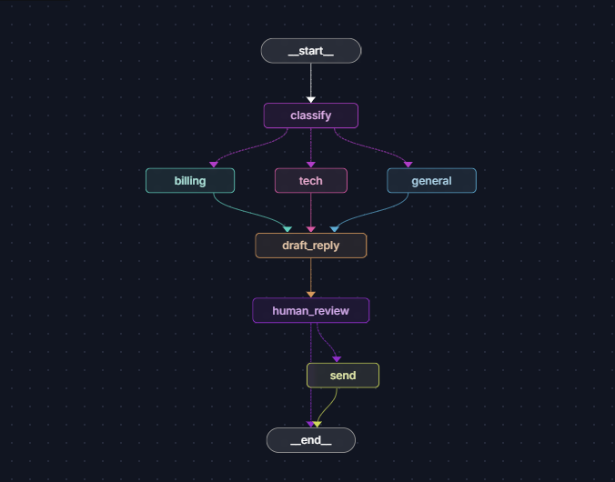
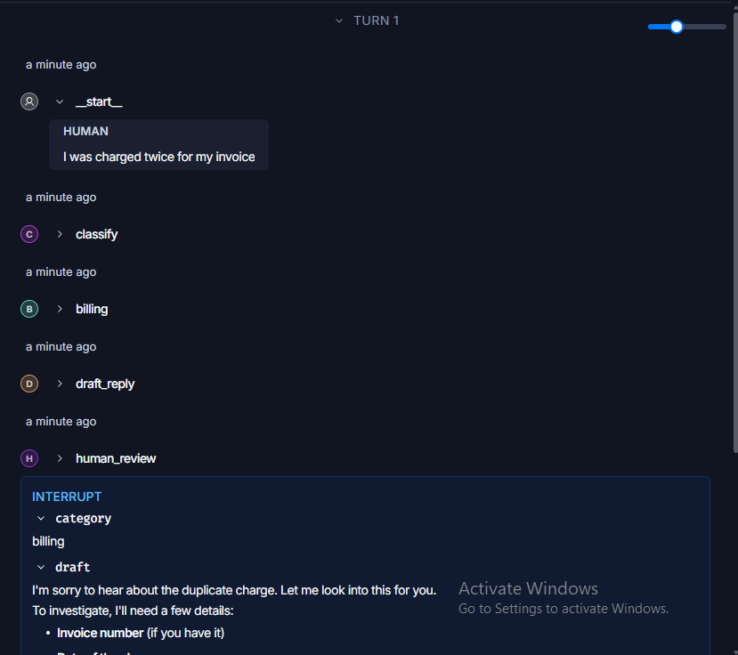
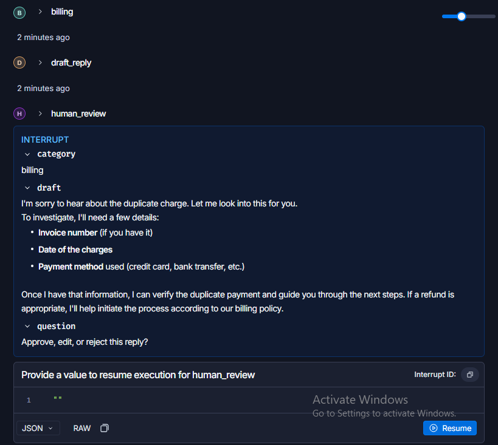
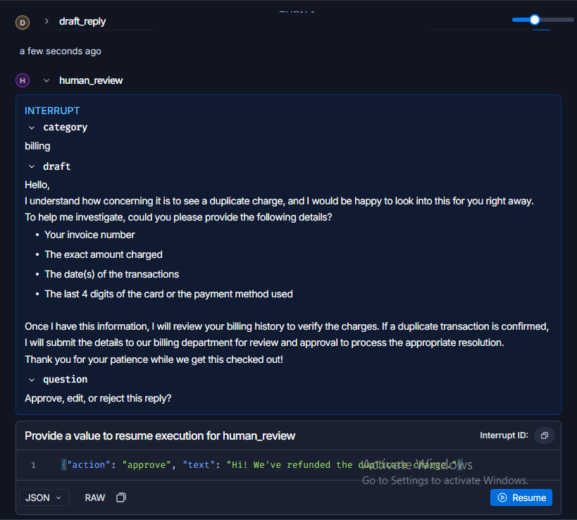
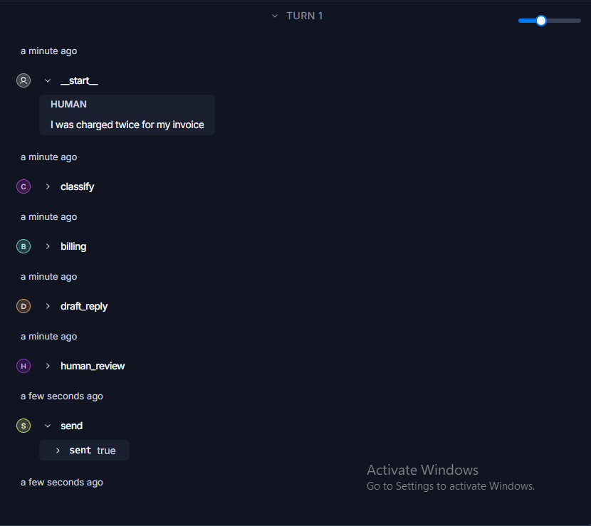
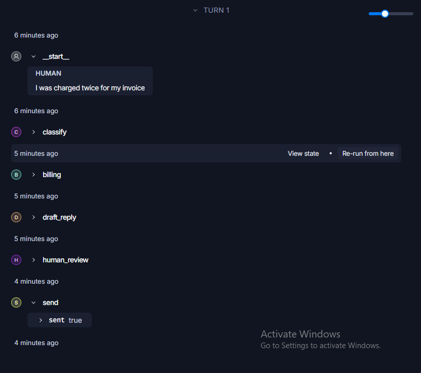
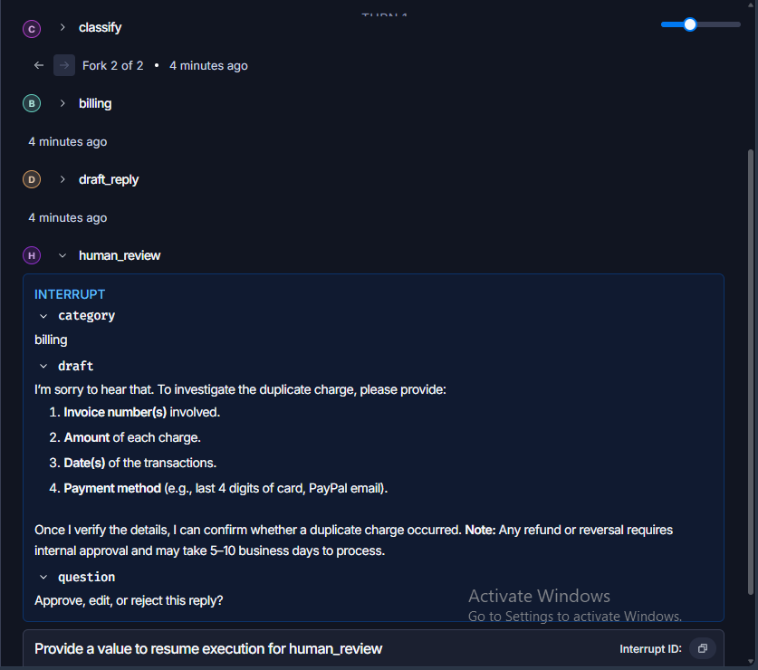

# Support-triage graph (LangGraph)

A support-triage graph built by hand with `StateGraph`: classify, route to billing / tech / general, draft a reply, pause for human approval, then send. Every step is checkpointed, so runs can be resumed, replayed and forked.

## Graph



## Interrupted run







## Replayed run



![Replayed from the checkpoint after classify]


## Run the demo script

```powershell
uv run .\triage\demo.py
```

## Run LangGraph Studio

```powershell
uv run langgraph dev
```

If Windows blocks the `langgraph` launcher, use:

```powershell
uv run python -m langgraph_cli dev --no-browser
```

Then open:

```
https://smith.langchain.com/studio/?baseUrl=http://127.0.0.1:2024
```

To resume an interrupt in Studio, enter a dictionary in RAW/JSON mode:

```json
{"action": "approve", "text": "Hi! We've refunded the duplicate charge."}
```
