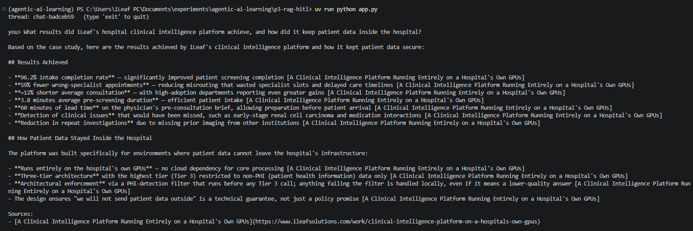
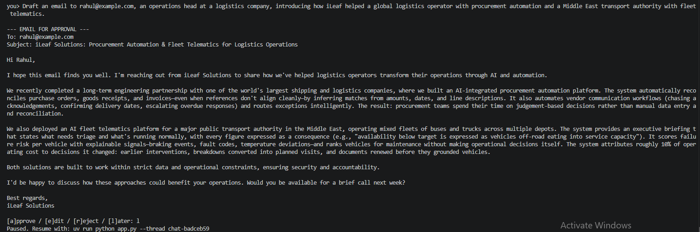

# Agentic RAG with human-in-the-loop (LangGraph)

An agent that answers questions about iLeaf's case studies with citations,
and drafts emails that only "send" after a human approves, edits or rejects them.

## How it works

- **Ingest** (`ingest.py`): scrapes the case studies from ileafsolutions.com/work,
  removes page noise, splits into chunks (800 chars, 100 overlap, title prefixed),
  embeds via the LLM gateway, stores in Chroma. PDFs/markdown in `data/` are also ingested.
- **Agent** (`agent.py`): LangGraph loop of agent node and tool node. Tools:
  `search_docs` (retriever, returns source titles and URLs) and `draft_email`.
- **Human in the loop** (`tools.py`): `draft_email` calls `interrupt()` with the draft.
  The human's answer comes back via `Command(resume={...})`.
- **Checkpointer**: SQLite (`checkpoints.db`), so a paused run survives the process
  ending and can be resumed later on the same `thread_id`.

## Run it

```powershell
uv sync
uv run python ingest.py        # once
uv run python app.py           # chat; add --thread <id> to resume
```

## Demo

### 1. Cited answer


### 2. Paused run


### 3. Same run, resumed after approval (new terminal)


## Design notes

- `interrupt()` re-runs the tool from its start on resume, so nothing with side
  effects happens before it. The send is after.
- The tool result tells the model exactly what the reviewer changed, so it
  does not mistake an edit for an error.
- SQLite instead of in-memory: in-memory state disappears when the process exits.
